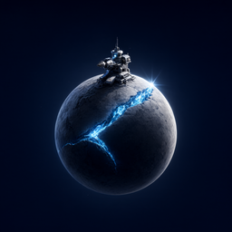

<p align="center"></p>

<h1 align="center">Starmine</h1>

<p align="center">
  <a href="https://github.com/paul-pch/starmine/actions/workflows/ci.yml"></a>
  <a href="https://github.com/paul-pch/starmine/releases/latest"></a>
</p>

<p align="center">
  Un jeu de gestion spatiale solo, en temps réel, pour Android.<br>
  Développe ta colonie, repousse les pirates, lance ta flotte. Hors ligne, sans compte, sans achat.
</p>

---

## Le jeu

Starmine reprend les règles d'un jeu de stratégie spatiale par navigateur classique et les adapte au jeu
solo sur téléphone. Le temps avance même quand l'application est fermée : on lance une construction,
on revient plus tard, et une notification prévient quand c'est fini.

- **Économie** : mines de métal et de cristal, synthétiseur de deutérium, centrales, entrepôts. La
  production dépend de l'énergie et de la température de la planète.
- **Recherche** : 12 technologies, avec prérequis, qui débloquent bâtiments, défenses et vaisseaux.
- **Défense** : chantier spatial, 8 défenses, simulateur de combat.
- **Raids pirates** : des flottes pirates attaquent la colonie, détectées à l'avance ; leur force suit
  la progression du joueur.
- **Flotte** : 8 vaisseaux, attaques de bases pirates, champ de débris et recycleurs, expéditions.
- **Officiers** : 8 officiers à débloquer en jouant, qui donnent des bonus permanents.
- **Événements** : 15 événements ponctuels (filon riche, tempête solaire, convoi marchand…), certains
  à choix ou à pari.
- **Illustrations** pour chaque bâtiment (selon le climat), technologie, unité et événement.

Aucun achat, jamais : ce qui serait payant ailleurs se gagne en jouant.

## Installer

1. Sur un téléphone **Android 15 ou plus récent** (arm64), ouvrir la
   [dernière release](https://github.com/paul-pch/starmine/releases/latest).
2. Télécharger le fichier `.apk` joint.
3. L'ouvrir et autoriser l'installation depuis cette source quand Android le demande.

Les mises à jour s'installent de la même façon, par-dessus la version existante : la partie est
conservée. Elle reste sur le téléphone ; l'écran Debug permet de l'exporter et de l'importer en JSON.

L'application n'est pas sur le Play Store et ne demande aucune connexion réseau.

## État du projet

Projet personnel, en développement actif. Versions livrées : économie, recherche, défense, raids
pirates, officiers, événements, flotte. Prochaine étape : la galaxie (colonisation, plusieurs
planètes). Détail dans la [roadmap](docs/specs/00-vision-roadmap.md).

## Développement

Flutter, Drift (SQLite) et notifications locales ; aucun backend.

```bash
flutter pub get
dart run build_runner build -d   # code Drift (*.g.dart, non commité)
flutter test
flutter run                      # signé avec la clé debug
```

| Dossier | Rôle | Dépendances autorisées |
| --- | --- | --- |
| `lib/domain/` | Règles, formules, moteur d'événements `advance()` | Dart pur uniquement (vérifié en CI) |
| `lib/data/` | Drift/SQLite, chargement de `assets/game_data.yaml`, export/import JSON | domain |
| `lib/ui/` | Écrans, notifications | domain, data |

Les paramètres de jeu (coûts, production, raids…) sont dans
[`assets/game_data.yaml`](assets/game_data.yaml), les formules dans le code.

- Specs fonctionnelles : [`docs/specs/`](docs/specs/README.md)
- Consignes de développement assisté : [`CLAUDE.md`](CLAUDE.md), `.claude/skills/`

## CI et releases

- Chaque push : format, `flutter analyze`, `flutter test`.
- Lancement manuel (Actions → CI → Run workflow) : APK release arm64 signé, en artefact (30 jours).
- Tag `v*` : APK et GitHub Release avec l'APK en pièce jointe.

```bash
git tag v0.1.0 && git push origin v0.1.0
```

Le `versionCode` vaut `github.run_number`, le `versionName` vient de `pubspec.yaml`.


## Crédits et mentions

- Les illustrations sont générées avec le modèle Qwen-Image-2.1, dont la licence limite l'usage :
  elles sont fournies **pour un usage non commercial uniquement** (voir
  [spec 11](docs/specs/11-visuels.md#licence)).
- Starmine est un projet de fan indépendant, inspiré d'OGame. Il n'est ni affilié à Gameforge ni
  approuvé par Gameforge, et ne reprend aucun de ses textes ni de ses images.
